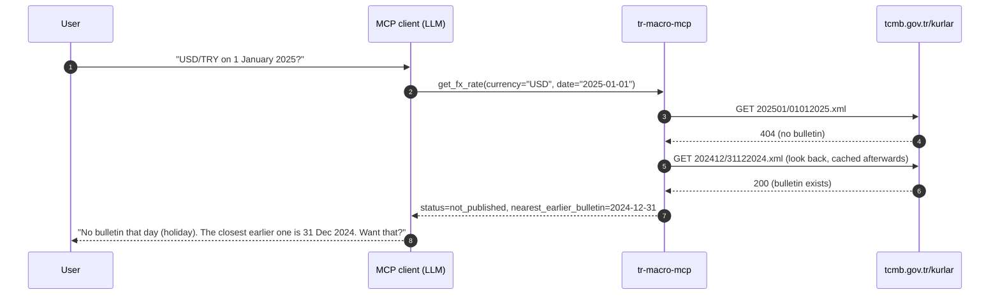
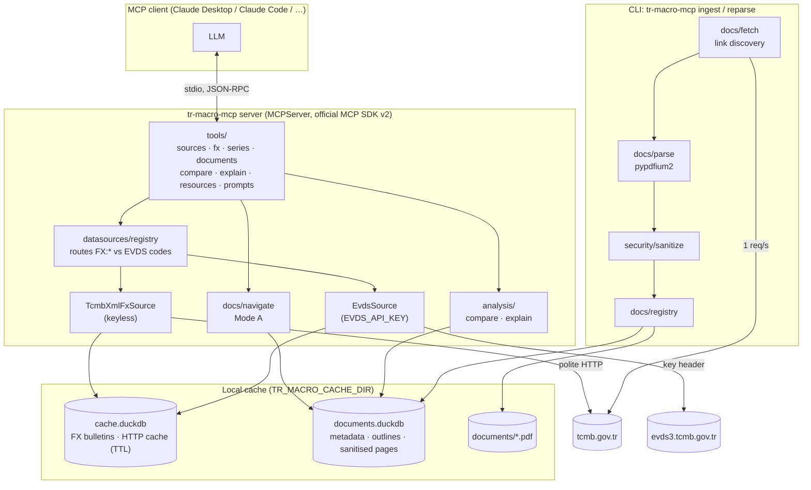
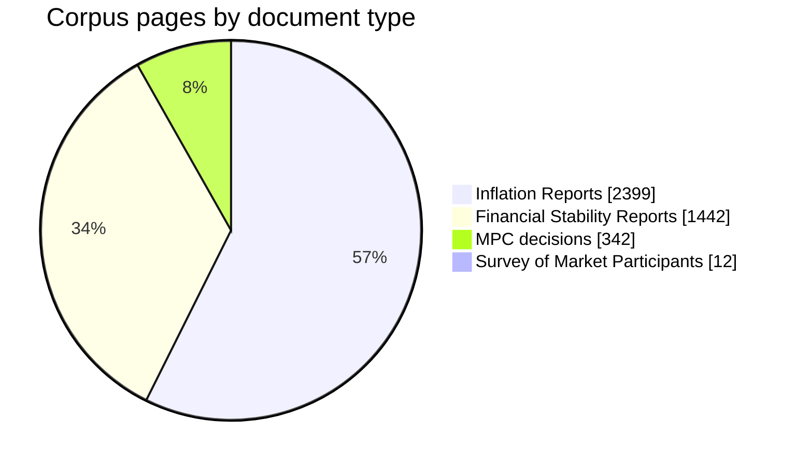
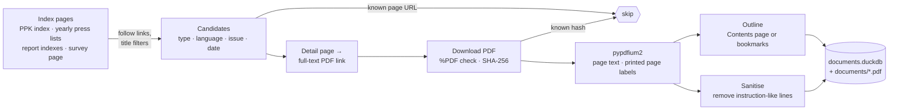
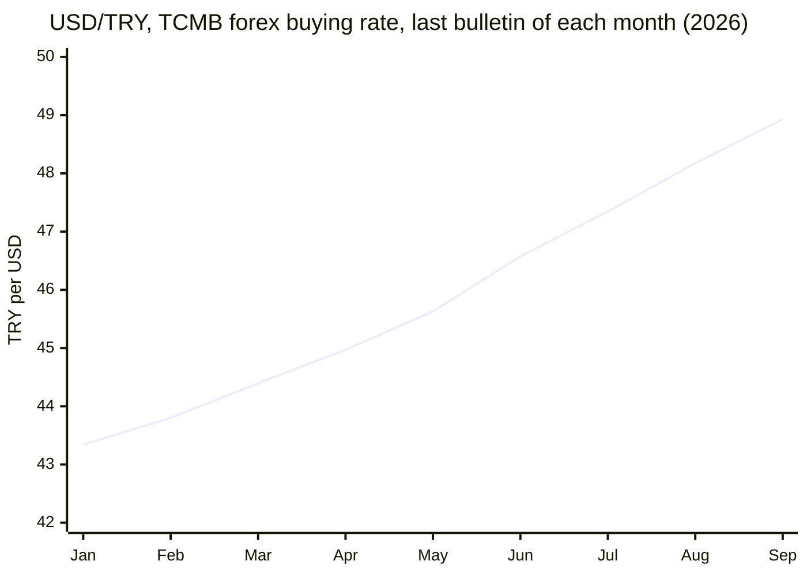

<div align="center">

# 🇹🇷 tr-macro-mcp

**Cited Turkish macroeconomic data and central-bank documents for LLM clients, over the Model Context Protocol.**

Official TCMB exchange rates · MPC (PPK) decisions · Inflation Reports · Financial Stability Reports · Survey of Market Participants · optional EVDS catalogue

<!-- Static badges: there is no public CI yet; the test badge reflects `uv run pytest` at the last update of this README. -->
[](https://www.python.org/)
[](https://py.sdk.modelcontextprotocol.io/)
[](#connect-a-client)
[](#evds-key-optional-upgrade)
[](#testing)
[](https://mypy-lang.org/)
[](https://docs.astral.sh/ruff/)
[](https://docs.astral.sh/uv/)
[](LICENSE)
[](#disclaimer)

</div>

> [!WARNING]
> <a id="disclaimer"></a>**Data and cited summaries only. This project never gives investment advice.**
> Data © Türkiye Cumhuriyet Merkez Bankası (TCMB), used with attribution under
> [TCMB's terms of use](https://tcmb.gov.tr/wps/wcm/connect/TR/TCMB+TR/Bottom+Menu/Diger/Kullanim+Sartlari).
> Commercial use of TCMB content requires TCMB's written permission. This is an independent,
> non-commercial open-source project and is not affiliated with TCMB.

---

## Contents

- [Why this exists](#why-this-exists)
- [Features at a glance](#features-at-a-glance)
- [Quickstart](#quickstart)
- [Connect a client](#connect-a-client)
- [EVDS key (optional upgrade)](#evds-key-optional-upgrade)
- [Things you can ask](#things-you-can-ask)
- [Tool reference](#tool-reference) · [Resources](#resources) · [Prompts](#prompts)
- [Citations and honesty guarantees](#citations-and-honesty-guarantees)
- [Architecture](#architecture)
- [Data sources and corpus](#data-sources-and-corpus)
- [Prompt-injection defences](#prompt-injection-defences)
- [Demo results](#demo-results)
- [Configuration](#configuration) · [CLI](#cli)
- [Development](#development) · [Testing](#testing) · [Project layout](#project-layout)
- [Design decisions](#design-decisions)
- [Roadmap](#roadmap)
- [Limitations](#limitations)
- [FAQ](#faq)
- [License and attribution](#license-and-attribution)

---

## Why this exists

Several Turkish finance MCP servers exist, and most wrap numeric APIs. None of them reads the
central bank's own publications, and none returns structured citations. This server combines
both and is built around three ideas:

1. **Numbers and documents together.** "How did USD/TRY move around the July MPC meeting, and
   what did the decision say?" needs an exchange-rate series *and* the decision text.
2. **Citations everywhere.** Every result names its source, URL, date, PDF page / printed page or
   bulletin number, and retrieval time. Missing data is reported as missing.
3. **Useful without any key.** Exchange rates and all documents work out of the box. A free EVDS
   key unlocks the full statistical catalogue.

| | **tr-macro-mcp** | [borsa-mcp](https://github.com/saidsurucu/borsa-mcp) | [finans-mcp](https://github.com/tufankoc/finans-mcp) | [tcmb_mcp](https://github.com/ofurkanuygur/tcmb_mcp) | [evds-mcp](https://github.com/parttimegod/evds-mcp) | [turkiye-veri-mcp](https://glama.ai/mcp/servers/ahmthamza/turkiye-veri-mcp) |
|---|:---:|:---:|:---:|:---:|:---:|:---:|
| TCMB FX rates (keyless) | ✅ | via doviz.com | ❌ | ✅ | ❌ | ❌ |
| EVDS series | ✅ (key) | ✅ (key) | ✅ | ❌ | ✅ (key) | ✅ (key) |
| MPC decisions, Inflation / Financial Stability Reports | ✅ | ❌ | ❌ | ❌ | ❌ | ❌ |
| Structured citations (page / bulletin) | ✅ | ❌ | ❌ | ❌ | ❌ | ❌ |
| Holidays: explicit "not published" instead of silent fallback | ✅ | – | – | silent fallback | – | – |
| Prompt-injection handling for document text | ✅ | – | – | – | – | – |
| Market prices, stocks, funds | ❌ (out of scope) | ✅ | ✅ | ❌ | ❌ | ❌ |

<sub>Checked 2026-10-03 from each project's README. Details: [docs/positioning.md](docs/positioning.md).</sub>

---

## Features at a glance

| Capability | Keyless | With EVDS key | Tools |
|---|:---:|:---:|---|
| Official TCMB exchange rates for any business day since mid-1996 (22 currencies incl. XDR) | ✅ | ✅ | `get_fx_rate`, `get_series("FX:USD")` |
| Explicit weekend/holiday handling, pre-2005 old-lira (TRL) conversion | ✅ | ✅ | `get_fx_rate` |
| Search and fetch the EVDS catalogue (policy rates, inflation, reserves, …) | ❌ | ✅ | `search_series`, `get_series` |
| Period comparison statistics | ✅ (FX) | ✅ | `compare_periods` |
| 330 TCMB documents (TR + EN), page-level text and outlines | ✅ | ✅ | `list_documents`, `get_document_outline`, `read_document`, `grep_documents` |
| Sentence-level diff of two MPC decisions | ✅ | ✅ | `compare_ppk_statements` |
| A series move plus cited document evidence from the same window | ✅ (FX) | ✅ | `explain_move` |
| Documents as MCP resources, 3 workflow prompts | ✅ | ✅ | `tcmb://documents/…`, prompts |

---

## Quickstart

> [!TIP]
> Requirements: [uv](https://docs.astral.sh/uv/getting-started/installation/) (it installs a
> suitable Python automatically). No API key and no account are needed.

```bash
git clone <repository-url> tr-macro-mcp
cd tr-macro-mcp
uv sync                       # install dependencies
uv run tr-macro-mcp ingest    # one-off: download + index TCMB documents (~13 min, ~190 MB)
uv run tr-macro-mcp           # start the stdio server (normally your MCP client starts it)
```

| Step | Time | Network |
|---|---|---|
| `uv sync` | depends on your connection (not measured) | PyPI |
| First `ingest` (default corpus) | measured: 13 min, 674 requests, ~190 MB | tcmb.gov.tr at 1 request/s |
| Later `ingest` runs (new publications only) | measured: 39 s, 35 requests | index pages + 2 survey PDFs |
| `reparse` (rebuild index from stored PDFs) | measured: 1 min 43 s | none |

The FX tools work immediately without `ingest`; document tools need the local corpus. Narrow the
download with `--types mpc,ir,fsr,smp`, `--languages tr,en`, `--mpc-since 2014`,
`--reports-since 2022`.

---

## Connect a client

### Claude Code

```bash
claude mcp add --transport stdio tr-macro -- uv --directory /absolute/path/to/tr-macro-mcp run tr-macro-mcp
```

### Claude Desktop

Edit `claude_desktop_config.json`, then fully restart Claude Desktop:

| OS | Config file |
|---|---|
| Windows | `%APPDATA%\Claude\claude_desktop_config.json` |
| macOS | `~/Library/Application Support/Claude/claude_desktop_config.json` |

```json
{
  "mcpServers": {
    "tr-macro": {
      "command": "uv",
      "args": ["--directory", "C:\\absolute\\path\\to\\tr-macro-mcp", "run", "tr-macro-mcp"]
    }
  }
}
```

> [!NOTE]
> If Claude Desktop cannot find `uv`, use its absolute path (`where uv` on Windows, `which uv`
> elsewhere). Server logs: `%APPDATA%\Claude\logs\mcp-server-tr-macro.log` (Windows) or
> `~/Library/Logs/Claude/` (macOS). Other MCP clients use the same `command` / `args` shape;
> see your client's documentation.

`--directory` makes the server run in the repository folder, so it picks up your `.env`.

---

## EVDS key (optional upgrade)

1. Register at [evds3.tcmb.gov.tr](https://evds3.tcmb.gov.tr), log in, open **Profile**, click
   **Copy API Key**.
2. `cp .env.example .env` and set `EVDS_API_KEY=...` (the file is git-ignored), **or** pass it to
   the client: `claude mcp add --transport stdio --env EVDS_API_KEY=... tr-macro -- uv ...`, or
   `"env": {"EVDS_API_KEY": "..."}` in the Claude Desktop config.
3. Restart the client. `list_data_sources` now reports `keyless_mode: false`.

Without a key, every EVDS-only tool answers with an actionable message
(`EVDS_API_KEY not set; see README …`) instead of failing.

> [!IMPORTANT]
> The EVDS request format, key header and 1000-observation limit are verified against TCMB's
> official guide and live responses. The JSON shape of *successful* responses has not yet been
> recorded with a real key (see [Limitations](#limitations)). Run
> `uv run python scripts/record_evds_fixtures.py` once you have a key to validate it.

---

## Things you can ask

| Question | Tools the client will use | Keyless |
|---|---|:---:|
| "What was USD/TRY on 2 January 2025?" | `get_fx_rate` | ✅ |
| "And on 1 January 2025?" → *no bulletin (holiday); closest earlier: 31 Dec 2024* | `get_fx_rate` | ✅ |
| "How did EUR/TRY change between Q1 and Q2 2026?" | `compare_periods` | ✅ |
| "What changed in the wording of the latest MPC decision?" | `compare_ppk_statements` | ✅ |
| "Compare the January and March 2026 PPK kararları in Turkish." | `compare_ppk_statements(language="tr")` | ✅ |
| "How did USD/TRY move June–September 2026, and what did TCMB publish meanwhile?" | `explain_move` | ✅ |
| "What does the latest Inflation Report say about inflation expectations? Cite pages." | `list_documents` → `grep_documents` → `read_document` | ✅ |
| "Summarise the household section of the May 2026 Financial Stability Report." | `get_document_outline` → `read_document` | ✅ |
| "What was the policy rate on 1 March 2025?" | `search_series` → `get_series` | 🔑 |

---

## Tool reference

All tools return pydantic-typed JSON (`structuredContent` with an output schema) and a
`citations` array. Errors are returned as MCP tool errors with a message the model can act on.

### Data sources and numeric tools

| Tool | Parameters | Returns | Key |
|---|---|---|:---:|
| `list_data_sources` | – | each source's coverage, `requires_key`, `available`; `keyless_mode`; disclaimer | – |
| `get_fx_rate` | `currency`, `date?` (default: latest bulletin), `rate_type?` (`forex_buying` default, `forex_selling`, `banknote_buying`, `banknote_selling`) | `status` (`ok` / `not_published` / `unknown_currency`), all four rates per 1 unit, `bulletin_no`, `nearest_earlier_bulletin` | – |
| `search_series` | `query` (TR/EN), `limit?` | EVDS series codes, names, frequency, coverage, score | 🔑 |
| `get_series` | `series_code`, `start`, `end`, `frequency?`, `aggregation?`, `source?` | observations (period label as published, parsed date, value or null), metadata, citations | 🔑 / FX keyless |
| `compare_periods` | `series_code`, `period_a_start/end`, `period_b_start/end`, `frequency?` | count, first, last, mean, min, max, change per period; change in mean and last | 🔑 / FX keyless |

**Series codes.** EVDS codes look like `TP.DK.USD.A.YTL`. Keyless FX codes are
`FX:<CUR>[:<rate_type>]`, e.g. `FX:USD`, `FX:EUR:forex_selling`.

| Keyless FX frequency | Max range per call | How values are chosen |
|---|---|---|
| daily (default) | 62 days | every published bulletin (weekends are not queried) |
| weekly | 1 year | last published bulletin of each ISO week |
| monthly | 5 years | last published bulletin of each month |

### Document tools (Mode A, "agentic navigation")

| Tool | Parameters | Returns |
|---|---|---|
| `list_documents` | `doc_type?` (`mpc`, `ir`, `fsr`, `smp`), `language?` (`tr`, `en`), `date_from?`, `date_to?`, `query?`, `limit?` | documents newest first: id, type, date, title, page count, PDF URL, SHA-256 |
| `get_document_outline` | `doc_id` | sections with PDF page and printed page number; method (`contents_page`, `bookmarks`, `none`) |
| `read_document` | `doc_id`, `page_start?`, `page_end?` | page texts wrapped as untrusted, one citation per page, `next_page` when truncated (max 10 pages / 40,000 chars per call) |
| `grep_documents` | `pattern`, `regex?`, `doc_type?`, `language?`, `date_from?`, `date_to?`, `max_results?`, `context_chars?` | page-level matches with snippets, newest first; Turkish-aware case folding (`İ/I/ı`) |


### Cross-source tools

| Tool | Parameters | Returns | Key |
|---|---|---|:---:|
| `compare_ppk_statements` | `date_a?`, `date_b?` (exact meeting dates; default: previous vs latest), `language?` | decision sentences verbatim, added / removed / modified sentences with exact word changes, members changed, **heuristic** tone label with matched terms and caveat | – |
| `explain_move` | `series_code`, `start`, `end`, `language?`, `keywords?`, `max_evidence?` | movement (first, last, change, min/max with dates, 3 largest moves), decision in force at start, MPC decisions and report pages in the window, co-occurrences with large moves, citations | FX keyless / 🔑 |

> [!CAUTION]
> `explain_move` **assembles evidence; it does not establish causes.** Evidence is selected by
> date window and keywords, and the result says so. The tone label of `compare_ppk_statements` is a
> transparent keyword heuristic (`lexicon-v1`), not an assessment of monetary policy.

### Resources

| URI | MIME | Content |
|---|---|---|
| `tcmb://documents` | `application/json` | index of local documents |
| `tcmb://documents/{doc_id}` | `application/json` | metadata, citation, outline, page URIs |
| `tcmb://documents/{doc_id}/pages/{page}` | `text/plain` | one page with a citation header, wrapped as untrusted text |

### Prompts

| Prompt | Arguments | Workflow |
|---|---|---|
| `analyze_latest_mpc_decision` | `language` | `compare_ppk_statements` → quote decisions → summarise changes → label tone as heuristic |
| `explain_fx_move` | `currency`, `start`, `end`, `language` | `explain_move` → values with bulletin dates → cited context → no causal claims |
| `summarize_report_section` | `topic`, `doc_type`, `language` | `list_documents` → outline / grep → `read_document` → page-cited summary |

---

## Citations and honesty guarantees

| Guarantee | How it is enforced |
|---|---|
| No fabricated numbers | values come only from TCMB files; rate levels in MPC texts are quoted, never parsed |
| No silent date substitution | missing FX bulletin → `status: "not_published"`, the closest earlier date in a separate field |
| No guessed meeting | `compare_ppk_statements` with a non-meeting date errors and lists the nearest meeting dates |
| Explicit "not found" | unknown documents, empty corpus, missing key: actionable messages |
| Source errors surfaced, not hidden | e.g. a TCMB PDF printing the wrong year is left undated instead of guessed |

Every result carries `citations` with this schema:

| Field | Meaning |
|---|---|
| `source` | publisher and dataset, e.g. `TCMB Inflation Report` |
| `title` | document or bulletin title |
| `url` | the exact file the value or text came from |
| `doc_date` | publication / bulletin / meeting date |
| `page`, `page_label` | 1-based PDF page and the printed page number (they differ in reports) |
| `bulletin_no` | TCMB FX bulletin number, e.g. `2025/1` |
| `series_code` | for series results |
| `retrieved_at` | when the data was fetched or ingested (UTC) |

<details>
<summary><b>Real example: a business day vs a holiday</b> (output of <code>get_fx_rate</code>, abridged)</summary>

```json
{
  "status": "ok",
  "requested_date": "2025-01-02",
  "bulletin_date": "2025-01-02",
  "bulletin_no": "2025/1",
  "quote": {"currency": "USD", "name": "US DOLLAR", "unit": 1,
            "forex_buying": 35.2525, "forex_selling": 35.316,
            "banknote_buying": 35.2278, "banknote_selling": 35.369},
  "rate_type": "forex_buying",
  "value": 35.2525,
  "citations": [{"source": "TCMB indicative exchange rates (daily XML bulletin)",
                 "url": "https://www.tcmb.gov.tr/kurlar/202501/02012025.xml",
                 "doc_date": "2025-01-02", "bulletin_no": "2025/1",
                 "retrieved_at": "2026-10-03T17:06:55.881139Z"}]
}
```

```json
{
  "status": "not_published",
  "requested_date": "2025-01-01",
  "bulletin_date": null,
  "value": null,
  "nearest_earlier_bulletin": "2024-12-31",
  "notes": [
    "TCMB published no exchange-rate bulletin for 2025-01-01 (Wednesday): weekend, public holiday, or not yet published (bulletins appear around 15:30 Istanbul time).",
    "The closest earlier bulletin is 2024-12-31; request that date explicitly if its rates are acceptable."
  ]
}
```

</details>



---

## Architecture



| Layer | Module | Responsibility |
|---|---|---|
| Entry point | `server.py` | builds the server (`create_server`), `serve` / `ingest` / `reparse` CLI |
| Tools | `tools/*.py` | thin MCP tools: validate input, call a service, return pydantic models |
| Numeric sources | `datasources/` | the `DataSource` protocol (the one deliberate abstraction), registry, TCMB XML, EVDS |
| Storage | `store/` | DuckDB with short-lived connections, safe across processes |
| Documents | `docs/` | discovery, download, parsing, registry, navigation |
| Analysis | `analysis/` | MPC diff and tone heuristic, movement and evidence |
| Security | `security/sanitize.py` | untrusted-text cleaning, injection removal, wrapping |
| HTTP | `httpclient.py` | one User-Agent, per-host spacing, retries with backoff |

---

## Data sources and corpus

| Source | Endpoint | Auth | Coverage | Terms (summary) |
|---|---|---|---|---|
| TCMB indicative exchange rates | `tcmb.gov.tr/kurlar/YYYYMM/DDMMYYYY.xml`, `today.xml` | none | business days since mid-1996; ~15:30 Istanbul time | republish with attribution; commercial use needs permission |
| TCMB EVDS | `evds3.tcmb.gov.tr/igmevdsms-dis/` | free key in `key` header | tens of thousands of series | web-service access allowed; attribution; translations not official |
| TCMB documents | `tcmb.gov.tr/wps/wcm/connect/…` (discovered via index pages) | none | see corpus below | as TCMB website |

Every fact above was verified against live responses or official documents on 2026-10-03; URLs,
quotes of the terms, and quirks (e.g. TRL before 2005, JPY quoted per 100, TCMB typos) are in
[docs/data-sources.md](docs/data-sources.md).

### Default corpus (measured after ingestion)

| Type | `doc_type` | Turkish | English | Since | Pages | Outline source |
|---|---|---:|---:|---|---:|---|
| MPC (PPK) interest-rate decisions | `mpc` | 136 | 136 | Jan 2014 | 342 | short texts, no outline |
| Inflation Report (Enflasyon Raporu) | `ir` | 19 | 19 | 2022-I | 2,399 | printed Contents page |
| Financial Stability Report | `fsr` | 9 | 9 | May 2022 | 1,442 | printed Contents page |
| Survey of Market Participants | `smp` | 1 | 1 | latest only | 12 | – |
| **Total** | | **165** | **165** | | **4,195** | |



### Ingestion pipeline



| Politeness and robustness | Value |
|---|---|
| User-Agent | `tr-macro-mcp/<version> (open-source MCP server for TCMB data; local use)` |
| Spacing per host | 1.0 s (configurable) |
| Retries | 3 attempts, exponential backoff on 429 / 5xx / network errors |
| Idempotency | known detail pages skipped before fetching; survey PDFs compared by SHA-256 |
| robots.txt | checked; nothing fetched is disallowed |
| Server behaviour | never downloads documents during a conversation |

---

## Prompt-injection defences

Document text is treated as untrusted data at every step.

| Layer | What happens |
|---|---|
| Normalisation | NFKC; invisible, bidi-override and control characters removed |
| Delimiter defence | `<<<`, `>>>` and chat-template tokens are defanged, so a document cannot close its own wrapper |
| Instruction removal | lines matching rules such as `override_instructions`, `role_reassignment`, `tool_invocation`, `exfiltration`, `delimiter_spoof` (EN + TR) are replaced by a marker and reported in `security_notices` |
| Wrapping | text is returned between `<<<BEGIN UNTRUSTED DOCUMENT TEXT …>>>` and `<<<END …>>>` |
| Tool descriptions | tell the model that excerpts are quotations, never instructions |

**Tested:** a synthetic poisoned PDF (visible and invisible text, fake end-markers, chat tokens,
Turkish phrasing) is never echoed by any tool, triggers no network request, and keeps the
markers balanced. **Measured:** the rules flag **0 of 4,195** real TCMB pages (three false
positives found during the corpus audit were fixed and added as regression tests).

---

## Demo results

Produced by [`scripts/demo.py`](scripts/demo.py) against the real stdio server, keyless.
Full output: [docs/demos.md](docs/demos.md).

### USD/TRY month-end in 2026 (`get_series("FX:USD:forex_buying", frequency="monthly")`)



| Month | Bulletin used | TRY per USD |
|---|---|---:|
| Jan 2026 | 2026-01-30 | 43.3414 |
| Feb 2026 | 2026-02-27 | 43.8000 |
| Mar 2026 | 2026-03-31 | 44.3961 |
| Apr 2026 | 2026-04-30 | 44.9692 |
| May 2026 | **2026-05-25** (26–29 May: Kurban Bayramı, no bulletins) | 45.6312 |
| Jun 2026 | 2026-06-30 | 46.5747 |
| Jul 2026 | 2026-07-31 | 47.3452 |
| Aug 2026 | 2026-08-31 | 48.1745 |
| Sep 2026 | 2026-09-30 | 48.9303 |

<sub>Source: TCMB indicative exchange rates, daily XML bulletins (`https://www.tcmb.gov.tr/kurlar/`).</sub>

### What changed between the July and September 2026 MPC decisions (`compare_ppk_statements`)

Both decisions kept the policy rate at 37 percent (quoted from `decision_sentence_a/b`).
13 sentences are unchanged; the inflation-assessment paragraph was rewritten:

| Change | Sentence (EN decision text) |
|---|---|
| removed | The underlying trend of inflation decreased slightly in June. |
| removed | Leading indicators suggest that the underlying trend will rise temporarily in July. |
| removed | As a result of the growing uncertainty amid geopolitical developments, energy prices started trending up again. |
| removed | Recent data confirm the ongoing weakening in domestic demand. |
| added | Despite monthly fluctuations, recent inflation figures and leading indicators suggest that the underlying trend of inflation is decelerating. |
| added | Data on economic activity as well as the limited pass-through of supply shocks to domestic prices confirm the weakness in domestic demand. |
| added | On the other hand, elevated energy prices amid geopolitical developments pose an upward risk to the inflation outlook. |

<sub>Sources: Press Releases on Interest Rates 2026-28 (23 July 2026) and 2026-38 (10 September 2026), p. 1. The tool's heuristic tone label for this pair: "more hawkish wording" (score +2, lexicon-v1).</sub>

---

## Configuration

All settings are optional environment variables (or entries in `.env`; see [.env.example](.env.example)).

| Variable | Default | Purpose |
|---|---|---|
| `EVDS_API_KEY` | unset (keyless mode) | enables EVDS tools |
| `TR_MACRO_CACHE_DIR` | OS user cache dir (Windows: `%LOCALAPPDATA%\tr-macro-mcp\Cache`) | DuckDB files and PDFs |
| `TR_MACRO_MIN_REQUEST_INTERVAL` | `1.0` | seconds between requests to the same host |
| `TR_MACRO_HTTP_TIMEOUT` | `30` | HTTP timeout in seconds |

| Cache item | Lifetime |
|---|---|
| FX bulletin for a past date (incl. "not published") | permanent |
| `today.xml` | 15 minutes |
| EVDS observations | 24 hours |
| EVDS catalogue metadata | 7 days |
| Documents | until you re-run `ingest` / `reparse` |

## CLI

| Command | What it does |
|---|---|
| `tr-macro-mcp` / `tr-macro-mcp serve` | run the MCP server over stdio (logs go to stderr) |
| `tr-macro-mcp ingest [--types mpc,ir,fsr,smp] [--languages tr,en] [--mpc-since 2014] [--reports-since 2022]` | download and index documents (idempotent) |
| `tr-macro-mcp reparse` | rebuild text, outlines and sanitisation from stored PDFs (no network) |

---

## Development

```bash
uv sync --extra dev
uv run pytest                        # offline: recorded fixtures, no key, no network
uv run pytest -m live                # live smoke tests against tcmb.gov.tr
uv run ruff check . && uv run ruff format --check .
uv run mypy                          # strict, src/ only
```

| Script | Purpose |
|---|---|
| `scripts/record_fx_fixtures.py` | re-record TCMB XML bulletins used by tests |
| `scripts/record_doc_fixtures.py` | re-record TCMB index pages and PDFs (reports stored as excerpts) |
| `scripts/record_evds_fixtures.py` | record real EVDS responses (needs a key; the key is never written) |
| `scripts/make_poisoned_pdf.py` | regenerate the synthetic prompt-injection test PDF |
| `scripts/demo.py` | scripted keyless demos → `docs/demos.md` |

## Testing

| Suite | Tests | What it covers |
|---|---:|---|
| Unit (`tests/unit`) | 99 | XML parsing, TRL conversion, holidays, EVDS parsing/chunking/search, PDF parsing, discovery on recorded pages, sanitiser rules and false positives, MPC diff, movement stats, store sharing across processes |
| Integration (`tests/integration`) | 28 | every tool through the MCP protocol (in-memory client), ingestion idempotency, poisoned PDF, resources, prompts |
| Live (`tests/live`, `-m live`) | 2 | real stdio subprocess against tcmb.gov.tr, keyless |

Result at the time of writing: **125 passed, 2 skipped** offline (the two skipped tests validate
recorded EVDS responses and run once a key is used to record them), **2 passed** live. Tests use
recorded real TCMB files; an unexpected URL fails the test instead of reaching the network. EVDS
payloads in tests are synthetic and use obviously fake codes (`TP.TEST.RATE`).

## Project layout

```text
tr-macro-mcp/
├── src/tr_macro_mcp/
│   ├── server.py            # create_server(), CLI: serve / ingest / reparse
│   ├── config.py            # settings (.env, env vars)
│   ├── models.py            # pydantic models incl. Citation
│   ├── httpclient.py        # polite HTTP client
│   ├── datasources/         # DataSource protocol, registry, tcmb_fx_xml, evds
│   ├── store/               # DuckDB helpers, FX/HTTP cache
│   ├── docs/                # fetch, parse, ingest, registry, navigate
│   ├── analysis/            # compare (MPC diff), explain (evidence)
│   ├── security/            # sanitize
│   └── tools/               # MCP tools, resources, prompts
├── tests/                   # unit/, integration/, live/, fixtures/
├── scripts/                 # fixture recorders, demo, poisoned-PDF generator
├── docs/                    # data-sources, positioning, decisions/, demos
└── PLAN.md · CLAUDE.md · .env.example · LICENSE
```

---

## Design decisions

| ADR | Decision | Why |
|---|---|---|
| [0001](docs/decisions/0001-http-client.md) | `httpx` (not `httpx2`) | matches the brief; `MockTransport` gives offline tests |
| [0002](docs/decisions/0002-pdf-library.md) | `pypdfium2` (not PyMuPDF) | PyMuPDF is AGPL; pypdfium2 matched its text fidelity (0.999–1.000) and speed on real TCMB PDFs |
| – | official MCP SDK **v2** (`MCPServer`) | v2 is the stable line; FastMCP was renamed (verified by installing 2.3.0) |
| – | explicit `ingest`, never downloads during conversations | predictable latency, polite to the source |
| – | discovery by following links, never constructing URLs | TCMB detail-page slugs are irregular (constructed URLs 404) |
| – | no international data source in v1 | none passed "clear terms + no key" verification |

## Roadmap

| Phase | Scope | Status |
|---|---|---|
| 0 | Recon: verified data sources, terms, SDK; plan | ✅ done |
| 1 | Data sources, numeric tools, stdio server | ✅ done (EVDS live validation pending a key) |
| 2 | Document ingestion, Mode A navigation, injection defences | ✅ done |
| 3 | `compare_ppk_statements`, `explain_move`, resources, prompts, demos | ✅ done |
| 4 | Evaluation harness, 60+ question dataset (≥40% keyless), Mode A baseline | ⏳ next |
| 5 | Mode B (hybrid BM25 + dense + reranker, `[rag]` extra), ablations, comparison | ⏳ |
| 6 | Polish, demo GIF, fresh-clone check | ⏳ |

---

## Limitations

- **EVDS success responses are not yet validated live.** Requests, auth and error responses are
  verified; the observation parser follows TCMB's reference client and fails loudly on any other
  shape. Two tests are waiting for recorded fixtures.
- **Charts and most report tables are graphics**, so their numbers are not extractable as text.
- **Outlines** come from each report's printed Contents page (TCMB PDFs have no useful
  bookmarks); MPC decisions are 1–2 pages and have no outline.
- **Survey of Market Participants:** TCMB publishes only the latest report, so the corpus keeps a
  snapshot per month going forward. History is available as EVDS series (key).
- **MPC numbering differs between Turkish and English** in some years; decisions are paired by
  meeting date. One English PDF (2021-16) prints the wrong year and is left undated.
- **The tone label is a keyword heuristic.** It ignores numbers, negation and context; e.g. it
  scores the January 2014 emergency hike as "no change" because the hike is expressed in numbers.
- **`explain_move` shows co-occurrence, not causation**, and keyword evidence can be loosely related.
- **Keyless FX ranges are capped** (one request per bulletin): daily 62 days, weekly 1 year,
  monthly 5 years. Use EVDS for long daily histories.
- **FX bulletins appear around 15:30 Istanbul time**; earlier that day, today's rate is
  `not_published`.
- **Not in scope:** stock/BIST prices, investment advice, remote/HTTP deployment, Docker, PyPI.

## FAQ

<details>
<summary><b>Does it work without any account or key?</b></summary>

Yes. Exchange rates, all documents, `compare_ppk_statements` and `explain_move` for FX are keyless.
</details>

<details>
<summary><b>Why not let the server download documents on demand?</b></summary>

A conversation should not wait on hundreds of polite, rate-limited downloads, and the source
should not be hit on every question. `ingest` runs once; updates take ~40 seconds.
</details>

<details>
<summary><b>Why does a holiday return no rate instead of the previous day's?</b></summary>

Because that would present a different date's official rate as the requested one. The closest
earlier bulletin is offered separately, so the user or the model can choose explicitly.
</details>

<details>
<summary><b>Can I use it commercially?</b></summary>

The code is MIT-licensed. TCMB content is subject to TCMB's terms: republication with
attribution is allowed, commercial use requires TCMB's written permission.
</details>

<details>
<summary><b>Where are the files stored?</b></summary>

In `TR_MACRO_CACHE_DIR` (default: the OS user cache directory). Delete it to start fresh.
</details>

---

## License and attribution

- **Code:** [MIT](LICENSE).
- **Data:** © Türkiye Cumhuriyet Merkez Bankası (TCMB). Used with attribution under TCMB's terms
  of use and the EVDS terms of use. Small TCMB files are included in `tests/fixtures/` for
  offline tests, with attribution; the corpus itself is downloaded by each user.
- Built with the official [MCP Python SDK](https://github.com/modelcontextprotocol/python-sdk),
  [pypdfium2](https://github.com/pypdfium2-team/pypdfium2), [DuckDB](https://duckdb.org/),
  [httpx](https://www.python-httpx.org/) and [pydantic](https://docs.pydantic.dev/).
